<p align="center">
  
</p>

<p align="center">
  <a href="https://www.python.org/downloads/"></a>
  <a href="LICENSE"></a>
  <a href="https://github.com/xkx121029/HappyClaw/releases"></a>
  <a href="https://github.com/astral-sh/ruff"></a>
  <a href="https://github.com/TencentCloud/Octop"></a>
</p>

<p align="center">
  <a href="#-quick-start">Quick Start</a> ·
  <a href="#-what-you-get">What You Get</a> ·
  <a href="#-architecture">Architecture</a> ·
  <a href="#-install">Install</a> ·
  <a href="#-configure-models">Configure Models</a> ·
  <a href="#-data-directory--backups">Data & Backups</a> ·
  <a href="#-relationship-with-octop">Octop lineage</a>
</p>

<p align="center">
  <b>English</b> · <a href="README_CN.md">中文</a>
</p>

---

> **Modified from Octop.** HappyClaw is built on [TencentCloud/Octop](https://github.com/TencentCloud/Octop) under the MIT license, and reshaped into a build for **exactly one person on one machine**: no account system, no login page, no invitations, roles or multi-tenant deployment. What does *not* change is the engine contract — the `octop` command, the `~/.octop/` data root, the `OCTOP_*` environment variables and the `/api` surface stay as they are, so existing installs and scripts keep working. [See what changed →](#-relationship-with-octop)

**HappyClaw** is a local AI workbench for one person. Install it, start it, open the browser, and you are working as the local user — there is nothing to register, no password to type, and no teammate to invite.

One Python process serves the web console, the CLI, IM channels and scheduled jobs, with state in one control-plane database and every workspace file under your home directory. Inside that process you can create several **experts** — each with its own model, workspace, skills, channels and cron jobs — talk to them in the browser, or reach them through Feishu, DingTalk, QQ, WeChat, WeCom, Telegram and Discord.

## 🚀 Quick Start

> A 5-minute, Windows-first walkthrough lives in [docs/quickstart.md](docs/quickstart.md).

<p align="center">
  
</p>

**Windows (PowerShell)**

```powershell
irm https://download.octop.cloud/octop/scripts/install.ps1 | iex
octop run
```

**macOS / Linux**

```bash
curl -fsSL https://download.octop.cloud/octop/scripts/install.sh | bash
octop run
```

Open **http://127.0.0.1:8088**. The first boot creates the local user automatically, opens straight into the workspace, and leaves one thing to do: configure a model under **Settings → Models**.

## ✨ What You Get

<p align="center">
  
</p>

- **Experts, not accounts.** Every expert owns its workspace, model, skills and cron jobs. Start from the bundled expert library or one of the 16 MBTI persona templates.
- **AgentTeams (Beta).** A coordinator schedules several experts for work that needs more than one perspective — see [docs/expert-teams.md](docs/expert-teams.md).
- **Channels and connectors.** Browser chat plus Feishu, DingTalk, QQ, WeChat, WeCom, Telegram and Discord on the IM side; Tencent Docs, Tencent Meeting, Notion, TickTick and the Feishu / WeCom CLIs through OAuth and MCP — see [docs/connectors.md](docs/connectors.md).
- **Knowledge, skills and plugins.** RAG over your own documents, per-expert skill switches, and third-party plugins installed from the console or the CLI.
- **Control surfaces.** Terminal AI+ (a browser shell), Browser AI+ (Chromium automation, screenshots, remote browsing) and Remote Desktop for Linux, Windows and macOS.
- **Automation.** Natural-language or cron schedules that run inside the same process and push their results back to the conversation.

## 🖥️ Web Console

After `octop run`, open **http://127.0.0.1:8088**:

| Page | What it does |
|------|--------------|
| **Chat** | Talk to experts and teams; attachments, tool calls and streaming replies |
| **Experts** | Create experts, pick library templates or MBTI personas, set models and workspaces |
| **Connectors** | OAuth applications and MCP gateways |
| **Channels** | IM platform setup |
| **Cron** | Visual scheduled-job management |
| **Knowledge** | Document corpora and semantic retrieval |
| **Plugins** | Install, enable and configure |
| **Control** | Remote desktop and Browser AI+ |
| **ACP** | Outbound coding-agent runners |
| **Settings** | Models, backups, TLS, bind address, logging |

Interactive API docs are off by default; set `"enable_api_docs": true` in `config.json` to serve `/api/docs`.

## 🧠 Architecture

<p align="center">
  
</p>

The whole stack is one process. `OctopServer.start()` wires the runtime tree in dependency order and attaches FastAPI/uvicorn; there is no worker, no external queue and no required service beyond the model provider you configure. Configuration, chat history, workspaces and credentials live in `~/.octop/`.

<details>
<summary><b>Repository layout</b></summary>

```text
src/octop/
  config.py    environment configuration
  launch.py    OctopServer boot + uvicorn
  infra/       business core (agents, gateway, cron, db, …)
  api/         HTTP layer — FastAPI routers and SSE
  cli/         CLI layer — Click commands
  dashboard/   built React SPA (wheel artifact)

dashboard/     frontend source (Vite) — edit here, then make build-frontend
docker/        Docker Compose, entrypoint, build scripts
docs/          usage and architecture documentation
tests/         unit/ + integration/
```

</details>

Full detail: [docs/architecture.md](docs/architecture.md).

## 📦 Install

| Method | Platform | Command |
|--------|----------|---------|
| One-liner | macOS / Linux | `curl -fsSL https://download.octop.cloud/octop/scripts/install.sh \| bash` |
| One-liner | Windows | `irm https://download.octop.cloud/octop/scripts/install.ps1 \| iex` |
| Repo script | macOS / Linux | `bash scripts/install.sh` |
| Repo script | Windows | `powershell -ExecutionPolicy Bypass -File scripts/install.ps1` |
| PyPI | Any | `pip install octop` |
| Docker | Any | `docker compose -f docker/docker-compose.yml up -d --build` |

Installers provision an isolated environment at `~/.octop/venv` and a command wrapper at `~/.octop/bin/octop`; system Python is untouched. Open a new terminal afterwards so `octop` is on your `PATH`.

Optional extras:

```bash
# Playwright Chromium for browser automation (skipped if system Chrome/Chromium exists)
bash scripts/install.sh --extras browser
```

Install flags (`--version`, `--from-source`; `--mirror` is Unix-only) are documented in [scripts/README.md](scripts/README.md).

### Docker

```bash
docker compose -f docker/docker-compose.yml up -d --build
# open http://localhost:8088
```

Single-user Docker needs no preset administrator password. The container initializes the database on first boot, binds the local owner automatically, and keeps data in `/data/.octop`. See [docker/README.md](docker/README.md).

### Upgrade

```bash
octop update
```

`octop update` replaces the program only; the database, workspaces, secrets and `config.json` under `~/.octop/` are preserved, and schema migrations run on the next boot. Back up first with `octop backup create`.

## ⚙️ Configure Models

Models are configured per expert, or centrally under **Settings → Models**.

```bash
octop models              # provider presets and model resolution
octop provider list       # configured providers
octop provider --help     # add / edit / remove providers
```

Supported providers include OpenAI-compatible APIs, Anthropic, AWS Bedrock, DashScope (Qwen) and local Ollama. Add a provider with its Base URL and API key, select models, then run **Test connection** before saving. Ollama connects to the local daemon and needs no API key.

Common commands:

```bash
octop agent list                 # experts
octop agent create               # create an expert
octop channel list               # IM channels
octop skills list --agent main   # skills
octop cron list                  # scheduled jobs
```

Environment variables and the full `config.json` schema: [docs/configuration.md](docs/configuration.md).

## 📁 Data Directory & Backups

```text
~/.octop/                          ← install and data root
├── config.json                    # process settings (port, TLS, database, …)
├── env                            # optional environment variables (API keys, …)
├── octop.db                       # SQLite control plane
├── secrets/                       # Tencent Cloud authorization cache (cloud/, cloud.key)
├── agents/<agent_id>/             # per-expert workspace (SOUL.md, skills, files)
├── security/tool_guard/           # shell allow / deny rules
├── plugins/                       # installed plugins (bundled plugins default off)
├── backups/                       # archives written by octop backup create
├── logs/                          # runtime logs
├── venv/                          # Python environment created by the installer
└── bin/octop                      # command wrapper
```

Set `OCTOP_HOME` to move the whole data root to another disk.

### Backup and restore

```bash
octop backup create              # archive DB + workspaces + config
octop backup restore <archive>   # restore into ~/.octop
octop backup auto status         # automatic backup settings
octop backup auto run            # run one automatic backup now
```

Automatic backups are **off by default** (`backup.auto_enabled`). Once enabled they run inside the `octop run` process daily at 04:00 and keep 7 archives. Retention only prunes `octop-auto-backup-*` archives; manual backups are never deleted.

> The CLI archive excludes chat history by default; add `--include-chats` for a full migration. Automatic backups and the tray "Back up now" action include chats (`backup.include_chats: true`). SQLite and PostgreSQL backups are not interchangeable — restore with the same database engine that produced the archive.

Step-by-step move / rollback commands: [docs/migration-and-restore.md](docs/migration-and-restore.md).

## 📖 CLI Reference

| Command | Description |
|---------|-------------|
| `octop init` | Bootstrap `~/.octop/` (database and runtime directories) |
| `octop run` | Start the server in the foreground |
| `octop service start` | Install and start as a system service (systemd / launchd) |
| `octop agent` | Create, list, start and stop experts |
| `octop channel` | Install and manage IM channels |
| `octop chats` | Session list and interactive chat |
| `octop acp` | stdio ACP server for IDEs |
| `octop cron` | Manage scheduled jobs |
| `octop models` / `octop provider` | Provider presets, resolution and credentials |
| `octop skills` | Enable or disable skills per expert |
| `octop plugin` | Install and manage third-party plugins |
| `octop backup` | Create and restore backups |
| `octop migrate` | Import an OpenClaw or Hermes Agent setup into an expert |
| `octop bridge` | Manage remote bridge peers |
| `octop cloud` | Tencent Cloud credential bridge (`tccli` import) |
| `octop memory` | Memory maintenance (backup and slim) |
| `octop update` | Check for and install updates |
| `octop clean` | Clear CLI state or wipe `~/.octop/` |

> `octop user`, `octop admin` and `octop captcha` are inherited from upstream Octop and remain for compatibility only; they do not gate access in this single-user build.

Full reference: [docs/cli.md](docs/cli.md).

## 🛠️ Development

**Prerequisites:** Python 3.12+, Node 18+, [uv](https://docs.astral.sh/uv/)

```bash
# Backend
make install
make all                   # format + lint + typecheck + test

# Frontend (separate terminal)
make dev-frontend          # Vite dev server on :5173
make build-frontend        # production build → src/octop/dashboard/
```

Individual targets: `make test`, `make lint`, `make typecheck`, `make format`. Release checks: [docs/RELEASE-CHECKLIST.md](docs/RELEASE-CHECKLIST.md).

## 🔒 Security & Privacy

- **Local-first** — config, chats, workspaces and credentials live in `~/.octop/`.
- **Local boundary** — binds to `127.0.0.1` by default; exposing it on a LAN requires an explicit `--host`.
- **Tool guardrails** — risky tools and shell commands follow the rules in `~/.octop/security/tool_guard/`.
- **PII redaction** — sensitive data is redacted before leaving the workspace.
- **No vendor lock-in** — swap model providers, storage backends and channels.

## 🧬 Relationship with Octop

HappyClaw is a modified build of Octop, not a rewrite. The agent runtime, gateway, API and plugin/skill system are the upstream engine; this repository changes the product around it.

| | Upstream Octop | This repository |
|---|---|---|
| Positioning | Self-hosted assistant for multiple users / teams | Single local user, one process, one machine |
| Accounts | Register, login, invitations, roles, JWT | No login surface; the local owner is created at first boot |
| Branding | Octop | HappyClaw (installers, dashboard, docs) |
| Engine contract | `octop`, `~/.octop/`, `OCTOP_*`, `/api` | Unchanged, kept for compatibility |
| License | MIT | MIT |

**What changed in this build**

- Documentation rewritten around "start it and work": no login, team, permission or multi-tenant setup chapters.
- Installers, Docker metadata, the dashboard and the CLI help text now present the product as HappyClaw.
- Legacy account tables, `/api/auth/*` endpoints and metadata flags remain in the schema but no longer participate in access control.
- Upstream team-era docs and some internal module names may still mention Octop; where they do, treat them as historical context.

**What stays the same**

- `octop` CLI, `~/.octop/` data root, `OCTOP_*` environment variables and the PyPI package name.
- Agent runtime (`octop-harness`), IM gateway (`octop-gateway`), REST/WS API, connectors, ACP, knowledge base, plugins and scheduling.
- Data and backup formats, so an upstream installation can be upgraded in place.

The change log for the single-user pass is in [CHANGELOG.md](CHANGELOG.md).

## ❓ FAQ

**The page at http://127.0.0.1:8088 does not open.**
Make sure `octop run` is still running without errors, and use the actual port if you changed it.

**Do I need to log in?**
No. There is no login page and no account system; the console opens as the local user.

**How do I reach it from another device on my LAN?**
`octop run --host 0.0.0.0 --port 8088`, or set `OCTOP_BIND_HOST=0.0.0.0`. This exposes the console to your LAN — make sure that is what you want.

**Model test connection fails.**
Check the API key, base URL, network access and account quota. For local models, confirm Ollama is running.

**Where is my data, and how do I move it?**
Everything is under `~/.octop/`. Run `octop backup create --include-chats -o <path>`, copy the archive to the new machine, then `octop backup restore <archive> --yes`. Full steps and rollback: [docs/migration-and-restore.md](docs/migration-and-restore.md).

**Port already in use?**
Start on another port with `octop run --port 8090`, or edit `port` in `~/.octop/config.json`.

More troubleshooting: [docs/user-guide.md](docs/user-guide.md).

## 🤝 Contributing

1. Fork the repository
2. Create a feature branch (`git checkout -b feature/amazing-feature`)
3. Run `make all` before submitting
4. Open a pull request

See [CONTRIBUTING.md](CONTRIBUTING.md). Security issues: [SECURITY.md](SECURITY.md). Module boundaries: [AGENTS.md](AGENTS.md).

## 📋 Changelog

See [CHANGELOG.md](CHANGELOG.md).

## 📄 License & Acknowledgements

MIT — see [LICENSE](LICENSE).

HappyClaw is derived from [TencentCloud/Octop](https://github.com/TencentCloud/Octop), and builds on its `octop-harness` (LangGraph chat runtime) and `octop-gateway` (IM channel pipeline) libraries. Thanks to the upstream maintainers and to the FastAPI, React and Ant Design projects this workbench is assembled from.
