<p align="center">
  
</p>

<p align="center">
  <a href="https://www.python.org/downloads/"></a>
  <a href="LICENSE"></a>
  <a href="https://github.com/xkx121029/HappyClaw/releases"></a>
  <a href="https://github.com/astral-sh/ruff"></a>
  <a href="https://github.com/TencentCloud/Octop"></a>
</p>

<p align="center">
  <a href="#-快速开始">快速开始</a> ·
  <a href="#-能做什么">能做什么</a> ·
  <a href="#-架构">架构</a> ·
  <a href="#-安装">安装</a> ·
  <a href="#-配置模型">配置模型</a> ·
  <a href="#-数据目录与备份">数据目录与备份</a> ·
  <a href="#-与上游-octop-的关系">修改自 Octop</a>
</p>

<p align="center">
  <a href="README.md">English</a> · <b>中文</b>
</p>

---

> **基于 Octop 修改。** HappyClaw 在 [TencentCloud/Octop](https://github.com/TencentCloud/Octop)（MIT）的基础上修改而来，产品形态收敛为**一个人、一台机器**：没有账号体系，没有登录页，没有邀请、角色与多租户部署。保持不变的是引擎契约——`octop` 命令、`~/.octop/` 数据目录、`OCTOP_*` 环境变量与 `/api` 接口，已有的安装与脚本可以继续使用。[查看改动范围 →](#-与上游-octop-的关系)

**HappyClaw** 是给个人使用的本地 AI 工作台。装好、启动、打开浏览器，就是以本机使用者的身份在工作：不需要注册，不需要密码，也没有队友要邀请。

同一个 Python 进程同时提供 Web 控制台、CLI、IM 通道与定时任务；状态集中在一个控制面数据库，所有工作区文件都留在自己的主目录下。你可以创建多个**专家**——每个专家拥有独立的模型、工作区、技能、通道与定时任务——在浏览器里对话，也可以把飞书、钉钉、QQ、微信、企业微信、Telegram、Discord 接进来。

## 🚀 快速开始

> Windows 优先的 5 分钟上手见 [docs/quickstart.md](docs/quickstart.md)。

<p align="center">
  
</p>

**Windows（PowerShell）**

```powershell
irm https://download.octop.cloud/octop/scripts/install.ps1 | iex
octop run
```

**macOS / Linux**

```bash
curl -fsSL https://download.octop.cloud/octop/scripts/install.sh | bash
octop run
```

打开 **http://127.0.0.1:8088**。首次启动会自动创建本机使用者，直接进入工作台；剩下要做的只有一件事：在「设置 → 模型」里配置一个模型。

## ✨ 能做什么

<p align="center">
  
</p>

- **专家，而不是账号。** 每个专家有自己的工作区、模型、技能与定时任务；可以从内置专家库或 16 种 MBTI 人格模板开始。
- **AgentTeams（Beta）。** 由协调者调度多位专家，处理需要多视角协作的多步任务——见 [docs/expert-teams.md](docs/expert-teams.md)。
- **通道与连接器。** 网页对话之外，IM 侧支持飞书、钉钉、QQ、微信、企业微信、Telegram、Discord；通过 OAuth 与 MCP 接入腾讯文档、腾讯会议、Notion、滴答清单以及飞书 / 企微 CLI——见 [docs/connectors.md](docs/connectors.md)。
- **知识、技能与插件。** 对本地文档做 RAG 检索，按专家启用技能，也可以从控制台或 CLI 安装第三方插件。
- **控制面。** 终端 AI+（浏览器内 Shell）、浏览器 AI+（Chromium 自动化、截图、远程浏览）与跨 Linux / Windows / macOS 的远程桌面。
- **自动化。** 用自然语言或 Cron 表达式创建任务，在同一个进程内按时执行并把结果推回会话。

## 🖥️ Web 控制台

`octop run` 启动后访问 **http://127.0.0.1:8088**：

| 页面 | 作用 |
|------|------|
| **对话** | 与专家或团队实时聊天；附件、工具调用与流式回复 |
| **专家** | 创建专家、选择专家库 / MBTI、配置模型与工作区 |
| **Connector** | OAuth 应用与 MCP 网关 |
| **通道** | IM 平台配置 |
| **定时任务** | 可视化 Cron 管理 |
| **知识库** | 文档语料与语义检索 |
| **插件** | 安装、启用与配置 |
| **控制** | 远程桌面与浏览器 AI+ |
| **ACP** | 配置出站编程 Agent Runner |
| **设置** | 模型、备份、TLS、监听地址与日志 |

交互式 API 文档默认关闭；在 `config.json` 中设置 `"enable_api_docs": true` 后访问 `/api/docs`。

## 🧠 架构

<p align="center">
  
</p>

整个栈就是一个进程。`OctopServer.start()` 按依赖顺序装配运行时树并挂载 FastAPI/uvicorn；没有独立 worker，没有外部队列，除了你自己配置的模型供应商之外不需要任何外部服务。配置、会话历史、工作区与凭据都在 `~/.octop/`。

<details>
<summary><b>仓库结构</b></summary>

```text
src/octop/
  config.py    环境变量配置
  launch.py    OctopServer 启动 + uvicorn
  infra/       业务核心（agents、gateway、cron、db …）
  api/         HTTP 层 — FastAPI 路由与 SSE
  cli/         CLI 层 — Click 命令
  dashboard/   构建后的 React SPA（wheel 产物）

dashboard/     前端源码（Vite）— 在此编辑，运行 make build-frontend
docker/        Docker Compose、入口脚本、构建脚本
docs/          使用与架构文档
tests/         unit/ + integration/
```

</details>

完整说明见 [docs/architecture.md](docs/architecture.md)。

## 📦 安装

| 方式 | 平台 | 命令 |
|------|------|------|
| 一键脚本 | macOS / Linux | `curl -fsSL https://download.octop.cloud/octop/scripts/install.sh \| bash` |
| 一键脚本 | Windows | `irm https://download.octop.cloud/octop/scripts/install.ps1 \| iex` |
| 仓库内脚本 | macOS / Linux | `bash scripts/install.sh` |
| 仓库内脚本 | Windows | `powershell -ExecutionPolicy Bypass -File scripts/install.ps1` |
| PyPI | 全平台 | `pip install octop` |
| Docker | 全平台 | `docker compose -f docker/docker-compose.yml up -d --build` |

安装脚本把运行环境放在 `~/.octop/venv`，并在 `~/.octop/bin/octop` 生成命令入口，不改动系统 Python。安装完成后请打开新终端，让 `octop` 进入 `PATH`。

可选组件：

```bash
# 浏览器自动化需要 Playwright Chromium（系统已有 Chrome/Chromium 时跳过）
bash scripts/install.sh --extras browser
```

安装选项（`--version`、`--from-source`；`--mirror` 仅 Unix 脚本提供）见 [scripts/README.md](scripts/README.md)。

### Docker

```bash
docker compose -f docker/docker-compose.yml up -d --build
# 打开 http://localhost:8088
```

单人模式下 Docker 不需要预置管理员密码。容器首次启动会初始化数据库并自动绑定本机使用者，数据保存在 `/data/.octop`。完整说明见 [docker/README.md](docker/README.md)。

### 升级

```bash
octop update
```

`octop update` 只替换程序本体，`~/.octop/` 下的数据库、工作区、密钥与 `config.json` 都会保留；数据库结构在下次启动时自动迁移。升级前建议先执行 `octop backup create`。

## ⚙️ 配置模型

模型按专家配置，也可以在控制台「设置 → 模型」中统一管理。

```bash
octop models              # 供应商预设与模型解析
octop provider list       # 已配置供应商
octop provider --help     # 供应商增删改查
```

支持 OpenAI 兼容 API、Anthropic、AWS Bedrock、DashScope（通义千问）与本地 Ollama。新增供应商时填写 Base URL 与 API Key，勾选模型后点「测试连接」，通过再保存。Ollama 连接本机守护进程，无需 API Key。

常用命令：

```bash
octop agent list                 # 专家列表
octop agent create               # 新建专家
octop channel list               # IM 通道
octop skills list --agent main   # 技能
octop cron list                  # 定时任务
```

环境变量与 `config.json` 的完整字段见 [docs/configuration.md](docs/configuration.md)。

## 📁 数据目录与备份

```text
~/.octop/                          ← 安装与数据根目录
├── config.json                    # 进程配置（端口、TLS、数据库等）
├── env                            # 可选环境变量（API Key 等）
├── octop.db                       # SQLite 控制面
├── secrets/                       # 腾讯云授权缓存（cloud/、cloud.key）
├── agents/<agent_id>/             # 各专家工作区（SOUL.md、skills、文件）
├── security/tool_guard/           # Shell 命令允许/拒绝规则
├── plugins/                       # 已安装插件（内置插件默认关闭）
├── backups/                       # octop backup create 生成的归档
├── logs/                          # 运行日志
├── venv/                          # 安装脚本创建的 Python 环境
└── bin/octop                      # 命令入口
```

数据目录可用 `OCTOP_HOME` 整体改到其他磁盘。

### 备份与恢复

```bash
octop backup create              # 生成归档（数据库 + 工作区 + 配置）
octop backup restore <归档文件>   # 恢复到 ~/.octop
octop backup auto status         # 自动备份配置
octop backup auto run            # 立即执行一次自动备份
```

自动备份默认**关闭**（`backup.auto_enabled`）。开启后在 `octop run` 进程内每天 04:00 执行，默认保留 7 份；只清理 `octop-auto-backup-*` 旧归档，不会删除手动备份。

> 命令行归档默认不含聊天历史，完整迁移时使用 `--include-chats`；自动备份与托盘「立即备份」默认包含会话（`backup.include_chats: true`）。SQLite 与 PostgreSQL 的备份不能跨引擎互恢，恢复前请确认运行中的数据库引擎与备份一致。

换机、回退的逐步命令见 [docs/migration-and-restore.md](docs/migration-and-restore.md)。

## 📖 CLI 速查

| 命令 | 说明 |
|------|------|
| `octop init` | 初始化 `~/.octop/`（数据库与运行目录） |
| `octop run` | 前台启动服务 |
| `octop service start` | 注册并启动系统服务（systemd / launchd） |
| `octop agent` | 创建、列出、启停专家 |
| `octop channel` | 安装与管理 IM 通道 |
| `octop chats` | 会话列表与交互式对话 |
| `octop acp` | 为 IDE 提供 stdio ACP 服务 |
| `octop cron` | 管理定时任务 |
| `octop models` / `octop provider` | 供应商预设、模型解析与凭据 |
| `octop skills` | 按专家启用/禁用技能 |
| `octop plugin` | 安装与管理第三方插件 |
| `octop backup` | 创建与恢复备份 |
| `octop migrate` | 把 OpenClaw / Hermes Agent 配置迁入一个专家 |
| `octop bridge` | 管理远程桥接节点 |
| `octop cloud` | 腾讯云凭据桥（`tccli` 导入） |
| `octop memory` | 记忆维护（备份与瘦身） |
| `octop update` | 检查并安装更新 |
| `octop clean` | 清理 CLI 状态或清空 `~/.octop/` |

> `octop user`、`octop admin`、`octop captcha` 继承自上游 Octop，仅为兼容保留；在单人版本中不参与访问控制。

完整参数见 [docs/cli.md](docs/cli.md)。

## 🛠️ 开发

**前置条件：** Python 3.12+、Node 18+、[uv](https://docs.astral.sh/uv/)

```bash
# 后端
make install
make all                   # format + lint + typecheck + test

# 前端（另开终端）
make dev-frontend          # Vite 开发服务器 :5173
make build-frontend        # 生产构建 → src/octop/dashboard/
```

单独执行：`make test`、`make lint`、`make typecheck`、`make format`。发布前检查见 [docs/RELEASE-CHECKLIST.md](docs/RELEASE-CHECKLIST.md)。

## 🔒 安全与隐私

- **本地优先**：配置、对话、工作区与凭据都在 `~/.octop/`，不上传第三方。
- **本机边界**：默认只监听 `127.0.0.1`；需要局域网访问时显式改 `--host`。
- **工具护栏**：高风险工具与 Shell 命令按 `~/.octop/security/tool_guard/` 规则审批。
- **敏感信息脱敏**：离开工作区前对敏感数据做遮盖。
- **无厂商锁定**：模型供应商、存储后端与 IM 通道都可替换。

## 🧬 与上游 Octop 的关系

HappyClaw 是 Octop 的**修改版**，不是重写。Agent 运行时、网关、API 与插件/技能体系沿用上游引擎，这个仓库改变的是围绕它的产品形态。

| | 上游 Octop | 本仓库 |
|---|---|---|
| 定位 | 面向多用户 / 团队的自托管助手 | 单人、单进程、单机 |
| 账号 | 注册、登录、邀请、角色、JWT | 无登录面；首次启动创建本机使用者 |
| 品牌 | Octop | HappyClaw（安装脚本、控制台、文档） |
| 引擎契约 | `octop`、`~/.octop/`、`OCTOP_*`、`/api` | 保持不变，兼容已有安装 |
| 许可 | MIT | MIT |

**本版本改了什么**

- 文档改写为「启动即工作」：删除登录、团队、权限与多租户部署章节。
- 安装脚本、Docker 元数据、控制台与 CLI 帮助文案统一为 HappyClaw。
- 旧账号表、`/api/auth/*` 端点与相关元数据字段保留在 schema 中，但不再参与访问控制。
- 上游团队时期的文档与部分内部模块名仍可能出现 Octop，请按历史背景理解。

**保持不变的部分**

- `octop` CLI、`~/.octop/` 数据目录、`OCTOP_*` 环境变量与 PyPI 包名。
- Agent 运行时（`octop-harness`）、IM 网关（`octop-gateway`）、REST/WS API、连接器、ACP、知识库、插件与定时任务。
- 数据与备份格式，上游安装可以直接在本仓库上升级。

单人化改造的变更记录见 [CHANGELOG.md](CHANGELOG.md)。

## ❓ 常见问题

**打不开 http://127.0.0.1:8088？**
确认 `octop run` 仍在运行且终端没有报错；改过端口就用实际端口访问。

**需要登录吗？**
不需要。没有登录页与账号体系，启动后直接以本机使用者身份进入。

**怎么让局域网里的其他设备访问？**
`octop run --host 0.0.0.0 --port 8088`，或设置 `OCTOP_BIND_HOST=0.0.0.0`。注意这会把控制台暴露给局域网，请自行确认网络环境。

**模型测试连接失败？**
检查 API Key、Base URL、网络连通性与账户配额；本地模型确认 Ollama 已在运行。

**数据在哪里？怎么迁移到新机器？**
全部在 `~/.octop/`。用 `octop backup create --include-chats -o <路径>` 生成归档，把归档拷到新机器后执行 `octop backup restore <归档> --yes`。完整步骤与回退方式见 [docs/migration-and-restore.md](docs/migration-and-restore.md)。

**忘记端口或被别的程序占用？**
换端口启动：`octop run --port 8090`；或修改 `~/.octop/config.json` 的 `port`。

更多问题与排障见 [docs/user-guide.md](docs/user-guide.md)。

## 🤝 参与贡献

1. Fork 本仓库
2. 创建功能分支（`git checkout -b feature/amazing-feature`）
3. 提交前运行 `make all`
4. 发起 Pull Request

完整指南见 [CONTRIBUTING.md](CONTRIBUTING.md)，安全问题见 [SECURITY.md](SECURITY.md)，模块边界见 [AGENTS.md](AGENTS.md)。

## 📋 更新日志

详见 [CHANGELOG.md](CHANGELOG.md)。

## 📄 许可证与致谢

本项目采用 [MIT License](LICENSE)。

HappyClaw 修改自 [TencentCloud/Octop](https://github.com/TencentCloud/Octop)，并依赖其 `octop-harness`（LangGraph 对话运行时）与 `octop-gateway`（IM 通道管线）。感谢上游维护者，以及本项目所组装的 FastAPI、React 与 Ant Design 社区。
